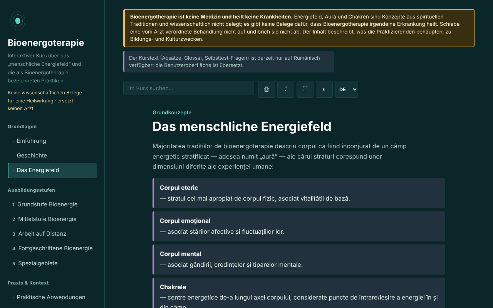

# Bioenergoterapie — interaktiver Kurs

[English](README.md) · [Română](README.ro.md) · [Français](README.fr.md) · [Italiano](README.it.md) · [Español](README.es.md) · [Português](README.pt.md) · **Deutsch** · [Magyar](README.hu.md)

**Version:** 1.3.3 · **Zuletzt aktualisiert:** 2026-10-22

Oberflächensprachen: **Română, English, Français, Italiano, Español, Português (PT), Deutsch, Magyar**

Ein Bildungskurs über Bioenergietherapie und das Pranic-Healing-System, in einer einzigen HTML-Datei, offline. Eine glaubensbasierte Praxis, ohne wissenschaftlichen Heilungsnachweis.

**Online-App:** https://chiuta.github.io/Bioenergoterapie/

> **Warnhinweis.** Bioenergietherapie ist keine Medizin und behandelt keine Krankheiten. Das Energiefeld, die Aura und die Chakren sind Konzepte aus spirituellen Traditionen und wissenschaftlich nicht belegt; es gibt keinen Nachweis, dass Bioenergietherapie irgendeine Erkrankung heilt. Verschiebe oder unterbrich keine vom Arzt verordnete Behandlung. Der Hinweis wird dauerhaft am oberen Rand jeder Seite der App angezeigt.

## Was es ist

Eine Lern-App auf Rumänisch über Bioenergietherapie, wie Praktizierende sie beschreiben: das „menschliche Energiefeld“, historische Eckpunkte (Therapeutic Touch, Pranic Healing, Qigong- und Prana-Traditionen), die fünf Stufen des Pranic-Healing-Systems als pädagogisches Gerüst, Vergleiche zwischen Traditionen, ein Glossar. Der Inhalt beschreibt, was die Praktizierenden behaupten, und empfiehlt keine Behandlungen. Historische Angaben und Angaben zu Rumänien, die ich nicht überprüfen konnte, sind mit „[neverificat]“ (nicht verifiziert) gekennzeichnet.

## Funktionen

Im Code und im Browser geprüft:
- 13 Abschnitte (Seitenmenü, ☰ auf dem Smartphone): Einführung, Geschichte, Das Energiefeld (mit einem SVG-Diagramm der Chakren-Achse), fünf Ausbildungsstufen mit Übungen, Praktische Anwendungen, Internationale Schulen, Glossar, Tagebuch, Selbsteinschätzung.
- Suche im Kurs, unempfindlich gegenüber diakritischen Zeichen.
- Direktlinks zu Abschnitten (zum Beispiel `#camp`); die „Zurück“-Taste des Browsers funktioniert zwischen den Abschnitten.
- Drucken (nur der angezeigte Abschnitt, schwarz-weiß), Teilen (Link), Vollbild, Bildschirm aktiv halten (wo der Browser es zulässt).
- Praxistagebuch: freier Text, als `.txt` herunterladbar und aus einer Datei wieder ladbar („Încarcă (.txt)“, mit Bestätigung, falls vorhandener Text ersetzt wird), mit einer Schaltfläche zum Einfügen von Datum und Uhrzeit in die Notiz und einer Bestätigung beim Leeren. Standardmäßig wird nichts im Browser gespeichert; die lokale Aufbewahrung ist eine Option, die du selbst ankreuzt.
- Selbsteinschätzung mit 10 Fragen und Erklärungen; die Reihenfolge der Antworten wird bei jedem Versuch gemischt; am Ende erscheinen Verweise auf die Abschnitte, die bei falschen Antworten noch einmal zu lesen sind.
- Beachtet `prefers-reduced-motion`; funktioniert ab 390 px Breite; ohne JavaScript werden alle Abschnitte angezeigt.

## Anleitung

1. Öffne die Seite und wähle einen Abschnitt im Menü links (auf dem Smartphone ☰ drücken).
2. Suche einen Begriff im Suchfeld; drücke die Eingabetaste oder wähle ein Ergebnis.
3. Die mit „Exercițiu practic“ (Praktische Übung) gekennzeichneten Übungen sind Aufmerksamkeits- und Visualisierungsübungen, keine therapeutischen Verfahren.
4. Schreibe im „Jurnal“ (Tagebuch) Notizen und lade sie (`.txt`) herunter, bevor du die Seite schließt: Standardmäßig wird nirgends gespeichert; optional kannst du „Păstrează jurnalul în acest browser“ (Tagebuch in diesem Browser behalten) ankreuzen.
5. Beantworte in der „Autoevaluare“ (Selbsteinschätzung) die Fragen; „Reia testul“ (Test wiederholen) mischt die Antworten erneut.

## Datenschutz und Netzwerk

- Lokaler Speicher: Standardmäßig schreibt die App nichts in `localStorage`, `sessionStorage`, IndexedDB oder Cookies, und das Tagebuch existiert nur im Speicher der Seite. Nur wenn du selbst „Păstrează jurnalul în acest browser“ ankreuzt, werden der (unverschlüsselte) Text und ein Indikator im `localStorage` gespeichert (Schlüssel `bioenergoterapie.jurnal.*`); Abwählen löscht sie.
- Netzwerk: Die App stellt keinerlei Netzwerkanfragen und enthält keine externen Links; eine CSP (`default-src 'none'`, Skript per SHA-256-Hash autorisiert, kein `'unsafe-inline'` für Skripte) blockiert jedes externe Laden. Im `<head>` erscheinen nur Adressen in den Open-Graph-Metadaten (`chiuta.github.io`), auf die die App nicht zugreift.
- Berechtigungen: Sie fordert keine Berechtigungen an. „Ecran activ“ (Screen Wake Lock) und „Distribuie“ (Teilen; Teilen-Menü oder Zwischenablage) funktionieren nur beim Drücken der Schaltflächen.
- Keine Telemetrie, keine Konten.

## Grenzen und Warnhinweise

- Es ist kein medizinisches Material und ersetzt weder Diagnose noch Behandlung. Bei jedem anhaltenden Symptom suche einen Arzt auf; die App empfiehlt kein Verfahren gegen Krankheiten.
- Das Energiefeld, die Aura, die Chakren und das „farbige Prana“ sind wissenschaftlich nicht belegt; kontrollierte Studien zu verwandten Praktiken (zum Beispiel Therapeutic Touch) haben keine Wirksamkeit über Placebo hinaus gefunden. Die Erwähnung eines 1998 in JAMA veröffentlichten Experiments stammt aus dem Gedächtnis des App-Autors und muss vor dem Zitieren überprüft werden.
- Die Struktur in fünf Stufen folgt dem Pranic-Healing-System und ist nicht die einzig mögliche Gliederung des Gebiets.
- Die Aussagen zum Status der Bioenergietherapie in Rumänien und zur „mitteleuropäischen Bioenergietherapie“ sind als nicht verifiziert gekennzeichnet.
- „Fern“-Praktiken werden als Prämisse der Praktizierenden dargestellt, ohne Wirkungsnachweis.

## Lokal / offline ausführen

Lade `index.html` herunter und öffne sie in einem Browser; sie braucht kein Internet. Für GitHub Pages veröffentliche das Repository (die Datei `.nojekyll` ist enthalten).

## Verlauf / Changelog

### 1.3.3 — 2026-10-22
- fff-kit 1.1.2: PBKDF2 mit 600.000 Iterationen, Schutz vor Clickjacking

### 1.3.2 — 2026-10-22
- Die confirm()/prompt()-Fenster des Browsers durch eigene, in die 8 Sprachen übersetzte Dialoge ersetzt (Tagebuch leeren, Ersetzen beim Laden einer Datei, manuelles Kopieren des Links).

### 1.2.0 — 2026-10-19
- In der Legende des Diagramms ein ♪-Link (neuer Tab) für jedes der 7 Zentren zu Aurora (`#<chakra>`; er startet keinen Ton), mit einem Warnhinweis: Die Frequenzen in Aurora sind eine moderne Konvention, gehören nicht zu Pranic Healing und haben keine nachgewiesene therapeutische Wirkung.

### 1.1.0 — 2026-10-14
- Datensicherung und Datenkennzeichnung (fff-kit).

### 1.0.0 — 12. Oktober 2026
- Die Version und das Datum der letzten Aktualisierung werden in der App angezeigt (Fußzeile).

### 11.10.2026 (dritte Aktualisierung) — 11. Oktober 2026
- Tagebuch: Option „Păstrează jurnalul în acest browser“ (standardmäßig aus, mit dem Hinweis, dass die Speicherung unverschlüsselt ist; Abwählen löscht die gespeicherte Kopie). Kein neuer Inhalt zu Praktiken oder Gesundheit.

### 11.10.2026 (zweite Aktualisierung) — 11. Oktober 2026
- Sicherheit: CSP mit `script-src` per SHA-256-Hash, ohne `'unsafe-inline'` für Skripte.
- Tagebuch: Wiederladen aus einer `.txt`-Datei und Einfügen von Datum und Uhrzeit (das Tagebuch bleibt nur im Speicher der Seite).
- Selbsteinschätzung: Verweise auf die erneut zu lesenden Abschnitte bei falsch beantworteten Fragen (kein neuer Inhalt).

### 11.10.2026 — 11. Oktober 2026
- Barrierefreiheit: h1-Überschrift im Hauptbereich (die im Seitenmenü war auf dem Smartphone verborgen); axe-Prüfung ohne Verstöße bei 1280 und 360 px.
- Das Tagebuch bleibt absichtlich nur im Speicher (Datenschutz); Warnung beim Verlassen der Seite und `.txt`-Download.

## Lizenz

MIT — siehe die Datei LICENSE.

## Autor

Alexio — Alexandru-Ionuț Chiuță, Kontakt: alexio@trom.tf

## Zusammenfassung

Bioenergoterapie ist ein rumänischsprachiger Offline-Kurs in einer einzigen Datei über „Bioenergietherapie“, wie Praktizierende sie beschreiben, gegliedert nach den Stufen des Pranic Healing, mit Geschichte, Vergleichen, Glossar, Übungstagebuch und einem Quiz mit 10 Fragen. Ein dauerhafter Hinweis stellt klar, dass die Praxis keine Medizin ist und keinen wissenschaftlichen Nachweis einer Heilwirkung hat; Energiefelder, Auren und Chakren sind wissenschaftlich nicht belegt. Die App stellt keine Netzwerkanfragen, nutzt keinen Browserspeicher und verlangt keine Berechtigungen. Nicht überprüfte historische und lokale Angaben sind im Text gekennzeichnet.
