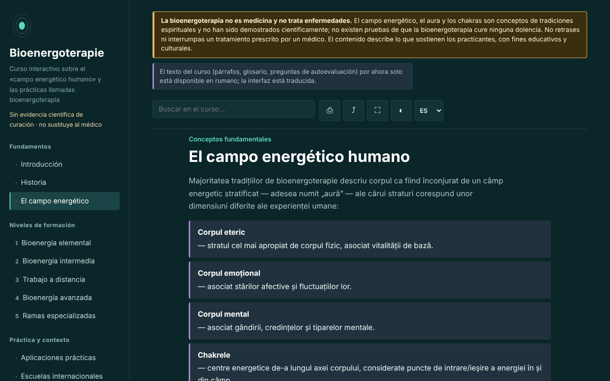

# Bioenergoterapie — curso interactivo

[English](README.md) · [Română](README.ro.md) · [Français](README.fr.md) · [Italiano](README.it.md) · **Español** · [Português](README.pt.md) · [Deutsch](README.de.md) · [Magyar](README.hu.md)

**Versión:** 1.3.0 · **Última actualización:** 2026-10-19

Idiomas de la interfaz: **Română, English, Français, Italiano, Español, Português (PT), Deutsch, Magyar**

Curso educativo sobre la bioenergoterapia y el sistema Pranic Healing, en un único archivo HTML, sin conexión. Práctica basada en creencias, sin pruebas científicas de curación.

**Aplicación en línea:** https://chiuta.github.io/Bioenergoterapie/

> **Advertencia.** La bioenergoterapia no es medicina y no trata enfermedades. El campo energético, el aura y los chakras son conceptos de tradiciones espirituales y no se han demostrado científicamente; no hay pruebas de que la bioenergoterapia cure ninguna afección. No retrases ni interrumpas un tratamiento prescrito por un médico. La advertencia se muestra de forma permanente en la parte superior de cada página de la aplicación.

## Qué es

Una aplicación de aprendizaje en rumano sobre la bioenergoterapia tal como la describen los practicantes: el «campo energético humano», hitos históricos (Therapeutic Touch, Pranic Healing, tradiciones del qigong y del prana), los cinco niveles del sistema Pranic Healing como armazón pedagógico, comparaciones entre tradiciones, un glosario. El contenido describe lo que sostienen los practicantes y no recomienda tratamientos. Los detalles históricos y los relativos a Rumanía que no he podido verificar están marcados como «[neverificat]» (sin verificar).

## Funciones

Comprobadas en el código y en el navegador:
- 13 secciones (menú lateral, ☰ en móvil): Introducción, Historia, El campo energético (con un diagrama SVG del eje de los chakras), cinco niveles de formación con ejercicios, Aplicaciones prácticas, Escuelas internacionales, Glosario, Diario, Autoevaluación.
- Búsqueda en el curso, insensible a los signos diacríticos.
- Enlaces directos a las secciones (por ejemplo `#camp`); el botón «atrás» del navegador funciona entre secciones.
- Impresión (solo la sección mostrada, en blanco y negro), compartir (enlace), pantalla completa, mantener la pantalla activa (donde el navegador lo permite).
- Diario de práctica: texto libre, descargable como `.txt` y recargable desde un archivo («Încarcă (.txt)», con confirmación si sustituye texto existente), con un botón para insertar la fecha y la hora en la nota y una confirmación al vaciar. Por defecto no se guarda nada en el navegador; la conservación local es una opción que marcas tú.
- Autoevaluación de 10 preguntas con explicaciones; el orden de las respuestas se baraja en cada intento; al final aparecen remisiones a las secciones que conviene releer por las respuestas erróneas.
- Respeta `prefers-reduced-motion`; funciona desde 390 px de ancho; sin JavaScript se muestran todas las secciones.

## Guía de uso

1. Abre la página y elige una sección en el menú de la izquierda (en móvil, pulsa ☰).
2. Busca un término en el campo de búsqueda; pulsa Intro o elige un resultado.
3. Los ejercicios marcados «Exercițiu practic» (Ejercicio práctico) son ejercicios de atención y visualización, no procedimientos terapéuticos.
4. En «Jurnal» (Diario) escribe notas y descárgalas (`.txt`) antes de cerrar la página: por defecto no se guarda en ningún sitio; opcionalmente puedes marcar «Păstrează jurnalul în acest browser» (Conservar el diario en este navegador).
5. En «Autoevaluare» (Autoevaluación) responde a las preguntas; «Reia testul» (Repetir la prueba) vuelve a barajar las respuestas.

## Privacidad y red

- Almacenamiento local: por defecto la aplicación no escribe nada en `localStorage`, `sessionStorage`, IndexedDB ni cookies, y el diario existe solo en la memoria de la página. Solo si marcas tú «Păstrează jurnalul în acest browser» se guardan en `localStorage` el texto (sin cifrar) y un indicador (claves `bioenergoterapie.jurnal.*`); al desmarcar se borran.
- Red: la aplicación no realiza ninguna solicitud de red y no contiene enlaces externos; una CSP (`default-src 'none'`, script autorizado mediante hash SHA-256, sin `'unsafe-inline'` para scripts) bloquea cualquier carga externa. En `<head>` solo aparecen direcciones en los metadatos Open Graph (`chiuta.github.io`), a las que la aplicación no accede.
- Permisos: no solicita permisos. «Ecran activ» (Screen Wake Lock) y «Distribuie» (Compartir; menú de compartir o portapapeles) funcionan solo al pulsar los botones.
- Cero telemetría, sin cuentas.

## Límites y advertencias

- No es material médico y no sustituye el diagnóstico ni el tratamiento. Ante cualquier síntoma persistente, acude al médico; la aplicación no recomienda ningún procedimiento para enfermedades.
- El campo energético, el aura, los chakras y el «prana de colores» no se han demostrado científicamente; las investigaciones controladas sobre prácticas afines (por ejemplo, el Therapeutic Touch) no han hallado eficacia más allá del placebo. La mención de un experimento publicado en JAMA en 1998 procede de la memoria del autor de la aplicación y debe verificarse antes de citarla.
- La estructura de cinco niveles sigue el sistema Pranic Healing y no es la única organización posible del ámbito.
- Las afirmaciones sobre la situación de la bioenergoterapia en Rumanía y sobre la «bioenergoterapia centroeuropea» están marcadas como no verificadas.
- Las prácticas «a distancia» se presentan como una premisa de los practicantes, sin pruebas de efecto.

## Ejecución local / sin conexión

Descarga `index.html` y ábrelo en un navegador; no necesita internet. Para GitHub Pages, publica el repositorio (el archivo `.nojekyll` está incluido).

## Historial / Changelog

### 1.2.0 — 2026-10-19
- En la leyenda del diagrama, un enlace ♪ (pestaña nueva) para cada uno de los 7 centros hacia Aurora (`#<chakra>`; no inicia el sonido), con una advertencia: las frecuencias de Aurora son una convención moderna, no forman parte del Pranic Healing y no tienen ningún efecto terapéutico demostrado.

### 1.1.0 — 2026-10-14
- Copia de seguridad y etiquetado de datos (fff-kit).

### 1.0.0 — 12 de octubre de 2026
- La versión y la fecha de la última actualización se muestran en la aplicación (pie de página).

### 11.10.2026 (tercera actualización) — 11 de octubre de 2026
- Diario: opción «Păstrează jurnalul în acest browser» (desactivada por defecto, con una advertencia de que el almacenamiento no está cifrado; al desmarcar se borra la copia guardada). Sin contenido nuevo sobre prácticas o salud.

### 11.10.2026 (segunda actualización) — 11 de octubre de 2026
- Seguridad: CSP con `script-src` mediante hash SHA-256, sin `'unsafe-inline'` para scripts.
- Diario: recarga desde un archivo `.txt` e inserción de la fecha y la hora (el diario permanece solo en la memoria de la página).
- Autoevaluación: remisiones a las secciones que conviene releer por las preguntas falladas (sin contenido nuevo).

### 11.10.2026 — 11 de octubre de 2026
- Accesibilidad: título h1 en el área principal (el del menú lateral estaba oculto en móvil); comprobación axe sin violaciones a 1280 y 360 px.
- El diario permanece solo en memoria, de forma intencionada (privacidad); aviso al abandonar la página y descarga `.txt`.

## Licencia

MIT — véase el archivo LICENSE.

## Autor

Alexio — Alexandru-Ionuț Chiuță, contacto: alexio@trom.tf

## Resumen

Bioenergoterapie es un curso en rumano, de un único archivo y sin conexión, sobre la «bioenergoterapia» tal como la describen los practicantes, estructurado en torno a los niveles de la Sanación Pránica, con historia, comparaciones, glosario, diario de práctica y un cuestionario de 10 preguntas. Un aviso permanente indica que la práctica no es medicina y que no tiene pruebas científicas de curación; los campos de energía, las auras y los chakras no están demostrados científicamente. La aplicación no hace solicitudes de red, no usa el almacenamiento del navegador y no solicita permisos. Las afirmaciones históricas y locales no verificadas se marcan en el texto.
