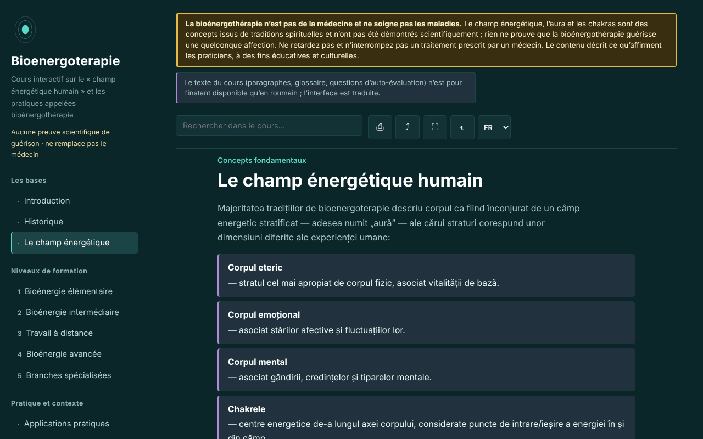

# Bioenergoterapie — cours interactif

[English](README.md) · [Română](README.ro.md) · **Français** · [Italiano](README.it.md) · [Español](README.es.md) · [Português](README.pt.md) · [Deutsch](README.de.md) · [Magyar](README.hu.md)

**Version :** 2.0.2 · **Dernière mise à jour :** 2026-10-27

**Statut :** stable ; étude descriptive (aucune allégation thérapeutique) · **Hors ligne :** complet (aucune requête réseau)

Langues de l'interface : **Română, English, Français, Italiano, Español, Português (PT), Deutsch, Magyar**

Cours éducatif sur la bioénergie thérapeutique et le système Pranic Healing, dans un seul fichier HTML, hors ligne. Pratique fondée sur des croyances, sans preuve scientifique de guérison.

**Application en ligne :** https://chiuta.github.io/Bioenergoterapie/

> **Avertissement.** La bioénergie thérapeutique n'est pas de la médecine et ne soigne pas les maladies. Le champ énergétique, l'aura et les chakras sont des concepts issus de traditions spirituelles et n'ont pas été démontrés scientifiquement ; il n'existe aucune preuve que la bioénergie thérapeutique guérisse une quelconque affection. Ne retardez pas et n'interrompez pas un traitement prescrit par un médecin. L'avertissement est affiché en permanence en haut de chaque page de l'application.

## Présentation

Une application d'apprentissage en roumain sur la bioénergie thérapeutique telle que la décrivent les praticiens : le « champ énergétique humain », des repères historiques (Therapeutic Touch, Pranic Healing, traditions du qigong et du prana), les cinq niveaux du système Pranic Healing comme trame pédagogique, des comparaisons entre traditions, un glossaire. Le contenu décrit ce que soutiennent les praticiens et ne recommande aucun traitement. Les détails historiques et ceux concernant la Roumanie que je n'ai pas pu vérifier sont marqués « [neverificat] » (non vérifié).

## Fonctionnalités

Vérifiées dans le code et dans le navigateur :
- 13 sections (menu latéral, ☰ sur mobile) : Introduction, Historique, Le champ énergétique (avec un schéma SVG de l'axe des chakras), cinq niveaux de formation avec exercices, Applications pratiques, Écoles internationales, Glossaire, Journal, Autoévaluation.
- Recherche dans le cours, insensible aux signes diacritiques.
- Liens directs vers les sections (par exemple `#camp`) ; le bouton « précédent » du navigateur fonctionne entre les sections.
- Impression (uniquement la section affichée, en noir et blanc), partage (lien), plein écran, maintien de l'écran allumé (là où le navigateur le permet).
- Journal de pratique : texte libre, téléchargeable en `.txt` et rechargeable depuis un fichier (« Încarcă (.txt) », avec confirmation s'il remplace du texte existant), avec un bouton pour insérer la date et l'heure dans la note et une confirmation à l'effacement. Par défaut, rien n'est enregistré dans le navigateur ; la conservation locale est une option que vous cochez vous-même.
- Autoévaluation de 10 questions avec explications ; l'ordre des réponses est mélangé à chaque tentative ; à la fin apparaissent des renvois vers les sections à relire pour les mauvaises réponses.
- Respecte `prefers-reduced-motion` ; fonctionne dès 390 px de largeur ; sans JavaScript, toutes les sections s'affichent.

## Mode d'emploi

1. Ouvrez la page et choisissez une section dans le menu de gauche (sur mobile, appuyez sur ☰).
2. Cherchez un terme dans le champ de recherche ; appuyez sur Entrée ou choisissez un résultat.
3. Les exercices marqués « Exercițiu practic » (Exercice pratique) sont des exercices d'attention et de visualisation, pas des procédures thérapeutiques.
4. Dans « Jurnal » (Journal), écrivez des notes et téléchargez-les (`.txt`) avant de fermer la page : par défaut, rien n'est enregistré nulle part ; vous pouvez éventuellement cocher « Păstrează jurnalul în acest browser » (Conserver le journal dans ce navigateur).
5. Dans « Autoevaluare » (Autoévaluation), répondez aux questions ; « Reia testul » (Refaire le test) mélange à nouveau les réponses.

## Confidentialité et réseau

- Stockage local : par défaut, l'application n'écrit rien dans `localStorage`, `sessionStorage`, IndexedDB ni dans des cookies, et le journal n'existe que dans la mémoire de la page. Ce n'est que si vous cochez vous-même « Păstrează jurnalul în acest browser » que le texte (non chiffré) et un indicateur sont enregistrés dans `localStorage` (clés `bioenergoterapie.jurnal.*`) ; décocher les supprime.
- Réseau : l'application n'effectue aucune requête réseau et ne contient aucun lien externe ; une CSP (`default-src 'none'`, script autorisé par hachage SHA-256, sans `'unsafe-inline'` pour les scripts) bloque tout chargement externe. Dans `<head>`, on ne trouve que des adresses dans les métadonnées Open Graph (`chiuta.github.io`), auxquelles l'application n'accède pas.
- Autorisations : aucune autorisation demandée. « Ecran activ » (Screen Wake Lock) et « Distribuie » (Partager ; menu de partage ou presse-papiers) ne fonctionnent qu'à l'appui sur les boutons.
- Zéro télémétrie, pas de comptes.

## Limites et avertissements

- Ce n'est pas un contenu médical et il ne remplace ni le diagnostic ni le traitement. Pour tout symptôme persistant, consultez un médecin ; l'application ne recommande aucune procédure pour les maladies.
- Le champ énergétique, l'aura, les chakras et le « prana coloré » n'ont pas été démontrés scientifiquement ; les recherches contrôlées sur des pratiques apparentées (par exemple le Therapeutic Touch) n'ont pas trouvé d'efficacité au-delà du placebo. La mention d'une expérience publiée dans JAMA en 1998 provient de la mémoire de l'auteur de l'application et doit être vérifiée avant d'être citée.
- La structure en cinq niveaux suit le système Pranic Healing et n'est pas la seule organisation possible du domaine.
- Les affirmations sur le statut de la bioénergie thérapeutique en Roumanie et sur la « bioénergie thérapeutique d'Europe centrale » sont marquées comme non vérifiées.
- Les pratiques « à distance » sont présentées comme une prémisse des praticiens, sans preuve d'effet.

## Exécution en local / hors ligne

Téléchargez `index.html` et ouvrez-le dans un navigateur ; il n'a pas besoin d'internet. Pour GitHub Pages, publiez le dépôt (le fichier `.nojekyll` est inclus).

## Historique / Changelog

### 1.3.4 — 2026-10-22
- fff-kit 1.1.4 : cibles tactiles et taille de texte minimale ; cibles tactiles/texte corrigés

### 1.3.3 — 2026-10-22
- fff-kit 1.1.2 : PBKDF2 600 000 itérations, protection anti-clickjacking

### 1.3.2 — 2026-10-22
- Les boîtes confirm()/prompt() du navigateur remplacées par des dialogues propres, traduits dans les 8 langues (vidage du journal, remplacement lors du chargement d'un fichier, copie manuelle du lien).

### 1.2.0 — 2026-10-19
- Dans la légende du schéma, un lien ♪ (nouvel onglet) pour chacun des 7 centres vers Aurora (`#<chakra>` ; il ne lance pas le son), avec un avertissement : les fréquences d'Aurora sont une convention moderne, ne font pas partie du Pranic Healing et n'ont aucun effet thérapeutique prouvé.

### 1.1.0 — 2026-10-14
- Sauvegarde et étiquetage des données (fff-kit).

### 1.0.0 — 12 octobre 2026
- La version et la date de la dernière mise à jour sont affichées dans l'application (pied de page).

### 11.10.2026 (troisième mise à jour) — 11 octobre 2026
- Journal : option « Păstrează jurnalul în acest browser » (désactivée par défaut, avec un avertissement indiquant que le stockage n'est pas chiffré ; décocher supprime la copie enregistrée). Aucun nouveau contenu sur les pratiques ou la santé.

### 11.10.2026 (deuxième mise à jour) — 11 octobre 2026
- Sécurité : CSP avec `script-src` par hachage SHA-256, sans `'unsafe-inline'` pour les scripts.
- Journal : rechargement depuis un fichier `.txt` et insertion de la date et de l'heure (le journal reste uniquement dans la mémoire de la page).
- Autoévaluation : renvois vers les sections à relire pour les questions ratées (sans nouveau contenu).

### 11.10.2026 — 11 octobre 2026
- Accessibilité : titre h1 dans la zone principale (celui du menu latéral était masqué sur mobile) ; vérification axe sans violation à 1280 et 360 px.
- Le journal reste uniquement en mémoire, volontairement (confidentialité) ; avertissement à la fermeture de la page et téléchargement `.txt`.

## Licence

MIT — voir le fichier LICENSE.

## Auteur

Alexio — Alexandru-Ionuț Chiuță, contact : alexio@trom.tf

## Résumé

Bioenergoterapie est un cours en roumain, en un seul fichier et hors ligne, sur la « thérapie bioénergétique » telle que la décrivent les praticiens, structuré autour des niveaux du Pranic Healing, avec histoire, comparaisons, glossaire, journal de pratique et quiz de 10 questions. Un avis permanent indique que cette pratique n'est pas une médecine et n'a aucune preuve scientifique de guérison ; les champs d'énergie, les auras et les chakras ne sont pas démontrés scientifiquement. L'application n'effectue aucune requête réseau, n'utilise aucun stockage du navigateur et ne demande aucune autorisation. Les affirmations historiques et locales non vérifiées sont signalées dans le texte.

