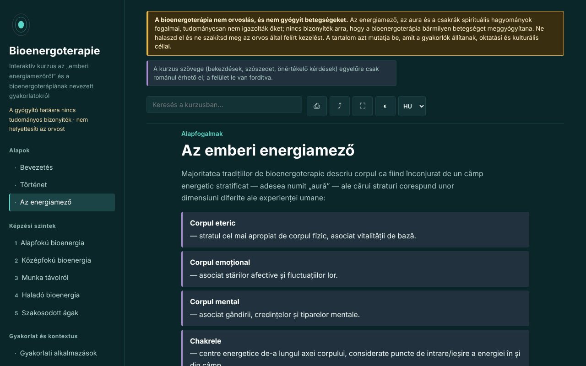

# Bioenergoterapie — interaktív tanfolyam

[English](README.md) · [Română](README.ro.md) · [Français](README.fr.md) · [Italiano](README.it.md) · [Español](README.es.md) · [Português](README.pt.md) · [Deutsch](README.de.md) · **Magyar**

**Verzió:** 1.3.2 · **Utolsó frissítés:** 2026-10-22

A felület nyelvei: **Română, English, Français, Italiano, Español, Português (PT), Deutsch, Magyar**

Oktatási tanfolyam a bioenergia-terápiáról és a Pranic Healing rendszerről, egyetlen, offline HTML-fájlban. Hiedelmeken alapuló gyakorlat, a gyógyítás tudományos bizonyítéka nélkül.

**Online alkalmazás:** https://chiuta.github.io/Bioenergoterapie/

> **Figyelmeztetés.** A bioenergia-terápia nem orvoslás, és nem kezel betegségeket. Az energiamező, az aura és a csakrák spirituális hagyományok fogalmai, tudományosan nem igazolták őket; nincs bizonyíték arra, hogy a bioenergia-terápia bármilyen betegséget meggyógyítana. Ne halaszd el, és ne szakítsd meg az orvos által felírt kezelést. A figyelmeztetés az alkalmazás minden oldalának tetején állandóan látható.

## Mi ez

Román nyelvű tanulóalkalmazás a bioenergia-terápiáról, ahogyan a gyakorlói leírják: az „emberi energiamező”, történeti támpontok (Therapeutic Touch, Pranic Healing, qigong- és prána-hagyományok), a Pranic Healing rendszer öt szintje pedagógiai vázként, hagyományok összehasonlítása, szószedet. A tartalom azt írja le, amit a gyakorlók állítanak, és nem ajánl kezeléseket. Azok a történeti és Romániára vonatkozó részletek, amelyeket nem tudtam ellenőrizni, „[neverificat]” (nem ellenőrzött) jelöléssel szerepelnek.

## Funkciók

A kódban és a böngészőben ellenőrizve:
- 13 szakasz (oldalmenü, mobilon ☰): Bevezetés, Történet, Az energiamező (a csakratengely SVG-ábrájával), öt képzési szint gyakorlatokkal, Gyakorlati alkalmazások, Nemzetközi iskolák, Szószedet, Napló, Önértékelés.
- Keresés a tanfolyamban, ékezetérzéketlenül.
- Közvetlen hivatkozások a szakaszokra (például `#camp`); a böngésző „vissza” gombja működik a szakaszok között.
- Nyomtatás (csak a megjelenített szakasz, fekete-fehérben), megosztás (hivatkozás), teljes képernyő, a képernyő ébren tartása (ahol a böngésző engedi).
- Gyakorlati napló: szabad szöveg, `.txt` fájlként letölthető és fájlból újratölthető („Încarcă (.txt)”, megerősítéssel, ha meglévő szöveget cserél), gombbal a dátum és az idő beszúrására a jegyzetbe, és megerősítéssel törléskor. Alapértelmezés szerint semmi nem mentődik a böngészőben; a helyi megőrzés olyan lehetőség, amelyet te jelölsz be.
- 10 kérdéses önértékelés magyarázatokkal; a válaszok sorrendje minden próbálkozásnál összekeveredik; a végén a hibás válaszoknál megjelennek a visszaolvasandó szakaszokra mutató hivatkozások.
- Tiszteletben tartja a `prefers-reduced-motion` beállítást; 390 px szélességtől működik; JavaScript nélkül minden szakasz megjelenik.

## Használati útmutató

1. Nyisd meg az oldalt, és válassz egy szakaszt a bal oldali menüből (mobilon nyomd meg a ☰ gombot).
2. Keress egy kifejezést a keresőmezőben; nyomj Entert, vagy válassz egy találatot.
3. Az „Exercițiu practic” (Gyakorlati feladat) jelölésű gyakorlatok figyelem- és vizualizációs gyakorlatok, nem terápiás eljárások.
4. A „Jurnal” (Napló) résznél írj jegyzeteket, és az oldal bezárása előtt töltsd le őket (`.txt`): alapértelmezés szerint sehol nem mentődik semmi; opcionálisan bejelölheted a „Păstrează jurnalul în acest browser” (Napló megőrzése ebben a böngészőben) lehetőséget.
5. Az „Autoevaluare” (Önértékelés) résznél válaszolj a kérdésekre; a „Reia testul” (Teszt újraindítása) ismét összekeveri a válaszokat.

## Adatvédelem és hálózat

- Helyi tárolás: alapértelmezés szerint az alkalmazás semmit nem ír a `localStorage`-ba, a `sessionStorage`-ba, az IndexedDB-be vagy a sütikbe, és a napló csak az oldal memóriájában létezik. Csak ha te magad bejelölöd a „Păstrează jurnalul în acest browser” lehetőséget, mentődik a (titkosítatlan) szöveg és egy jelző a `localStorage`-ba (kulcsok: `bioenergoterapie.jurnal.*`); a jelölés törlése eltávolítja őket.
- Hálózat: az alkalmazás semmilyen hálózati kérést nem indít, és nem tartalmaz külső hivatkozásokat; a CSP (`default-src 'none'`, a szkript SHA-256 hash-sel engedélyezve, szkriptekhez `'unsafe-inline'` nélkül) minden külső betöltést blokkol. A `<head>`-ben csak az Open Graph metaadatokban szerepelnek címek (`chiuta.github.io`), amelyeket az alkalmazás nem ér el.
- Engedélyek: nem kér engedélyeket. Az „Ecran activ” (Screen Wake Lock) és a „Distribuie” (Megosztás; megosztási menü vagy vágólap) csak a gombok megnyomásakor működik.
- Nulla telemetria, nincsenek fiókok.

## Korlátok és figyelmeztetések

- Nem orvosi anyag, és nem helyettesíti a diagnózist vagy a kezelést. Bármilyen tartós tünet esetén fordulj orvoshoz; az alkalmazás nem ajánl semmilyen eljárást betegségekre.
- Az energiamezőt, az aurát, a csakrákat és a „színes pránát” tudományosan nem igazolták; a rokon gyakorlatokról (például a Therapeutic Touchról) szóló kontrollált kutatások nem találtak a placebón túli hatékonyságot. Az 1998-ban a JAMA-ban megjelent kísérlet említése az alkalmazás szerzőjének emlékezetéből származik, és idézés előtt ellenőrizni kell.
- Az ötszintes szerkezet a Pranic Healing rendszert követi, és nem az egyetlen lehetséges felosztása a területnek.
- A bioenergia-terápia romániai helyzetére és a „közép-európai bioenergia-terápiára” vonatkozó állítások nem ellenőrzöttként vannak jelölve.
- A „távoli” gyakorlatokat a gyakorlók kiindulópontjaként mutatja be, hatásbizonyíték nélkül.

## Helyi / offline futtatás

Töltsd le az `index.html` fájlt, és nyisd meg egy böngészőben; nincs szüksége internetre. A GitHub Pageshez tedd közzé a tárolót (a `.nojekyll` fájl mellékelve van).

## Előzmények / Changelog

### 1.3.2 — 2026-10-22
- A böngésző confirm()/prompt() ablakait saját, mind a 8 nyelvre lefordított párbeszédablakok váltják (a napló törlése, cseréje fájl betöltésekor, a hivatkozás kézi másolása).

### 1.2.0 — 2026-10-19
- Az ábra jelmagyarázatában a 7 központ mindegyikéhez egy ♪ hivatkozás (új lapon) az Aurorára (`#<csakra>`; nem indítja el a hangot), figyelmeztetéssel: az Aurora frekvenciái modern megállapodáson alapulnak, nem részei a Pranic Healingnek, és nincs bizonyított terápiás hatásuk.

### 1.1.0 — 2026-10-14
- Biztonsági mentés és adatcímkézés (fff-kit).

### 1.0.0 — 2026. október 12.
- A verzió és az utolsó frissítés dátuma megjelenik az alkalmazásban (lábléc).

### 11.10.2026 (harmadik frissítés) — 2026. október 11.
- Napló: „Păstrează jurnalul în acest browser” lehetőség (alapértelmezés szerint kikapcsolva, figyelmeztetéssel, hogy a tárolás titkosítatlan; a jelölés törlése törli a mentett másolatot). Nincs új tartalom gyakorlatokról vagy egészségről.

### 11.10.2026 (második frissítés) — 2026. október 11.
- Biztonság: CSP `script-src`-vel SHA-256 hash alapján, szkriptekhez `'unsafe-inline'` nélkül.
- Napló: újratöltés `.txt` fájlból és a dátum és idő beszúrása (a napló csak az oldal memóriájában marad).
- Önértékelés: a hibás kérdéseknél visszaolvasandó szakaszokra mutató hivatkozások (új tartalom nélkül).

### 11.10.2026 — 2026. október 11.
- Akadálymentesség: h1 cím a fő területen (az oldalmenüben lévő mobilon el volt rejtve); axe-ellenőrzés szabálysértés nélkül 1280 és 360 px-en.
- A napló szándékosan csak a memóriában marad (adatvédelem); figyelmeztetés az oldal elhagyásakor és `.txt` letöltés.

## Licenc

MIT — lásd a LICENSE fájlt.

## Szerző

Alexio — Alexandru-Ionuț Chiuță, elérhetőség: alexio@trom.tf

## Összefoglaló
A Bioenergoterapie egyfájlos, offline, román nyelvű tanfolyam a „bioenergia-terápiáról”, ahogyan a gyakorlók leírják, a Pranic Healing szintjei köré építve, történettel, összehasonlításokkal, szószedettel, gyakorlási naplóval és 10 kérdéses kvízzel. Egy állandó figyelmeztetés közli, hogy a gyakorlat nem orvoslás, és a gyógyító hatására nincs tudományos bizonyíték; az energiamezők, aurák és csakrák tudományosan nem igazoltak. Az alkalmazás nem kezdeményez hálózati kéréseket, nem használ böngészőtárolót, és nem kér engedélyeket. Az ellenőrizetlen történeti és helyi állítások a szövegben jelölve vannak.
