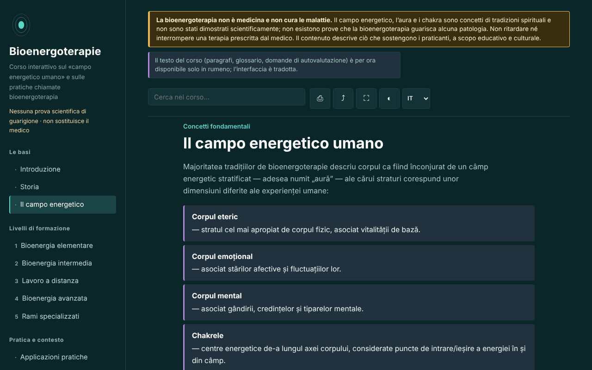

# Bioenergoterapie — corso interattivo

[English](README.md) · [Română](README.ro.md) · [Français](README.fr.md) · **Italiano** · [Español](README.es.md) · [Português](README.pt.md) · [Deutsch](README.de.md) · [Magyar](README.hu.md)

**Versione:** 1.3.2 · **Ultimo aggiornamento:** 2026-10-22

Lingue dell'interfaccia: **Română, English, Français, Italiano, Español, Português (PT), Deutsch, Magyar**

Corso educativo sulla bioenergoterapia e sul sistema Pranic Healing, in un unico file HTML, offline. Pratica basata su credenze, senza prove scientifiche di guarigione.

**App online:** https://chiuta.github.io/Bioenergoterapie/

> **Avvertenza.** La bioenergoterapia non è medicina e non cura le malattie. Il campo energetico, l'aura e i chakra sono concetti di tradizioni spirituali e non sono stati dimostrati scientificamente; non esistono prove che la bioenergoterapia guarisca alcuna patologia. Non ritardare né interrompere una terapia prescritta dal medico. L'avvertenza è mostrata in modo permanente nella parte alta di ogni pagina dell'app.

## Che cos'è

Un'app di apprendimento in rumeno sulla bioenergoterapia così come la descrivono i praticanti: il «campo energetico umano», riferimenti storici (Therapeutic Touch, Pranic Healing, tradizioni del qigong e del prana), i cinque livelli del sistema Pranic Healing come impalcatura pedagogica, confronti fra tradizioni, un glossario. Il contenuto descrive ciò che sostengono i praticanti e non raccomanda trattamenti. I dettagli storici e quelli sulla Romania che non ho potuto verificare sono contrassegnati «[neverificat]» (non verificato).

## Funzioni

Verificate nel codice e nel browser:
- 13 sezioni (menu laterale, ☰ su mobile): Introduzione, Storia, Il campo energetico (con un diagramma SVG dell'asse dei chakra), cinque livelli di formazione con esercizi, Applicazioni pratiche, Scuole internazionali, Glossario, Diario, Autovalutazione.
- Ricerca nel corso, insensibile ai segni diacritici.
- Link diretti alle sezioni (per esempio `#camp`); il pulsante «indietro» del browser funziona fra le sezioni.
- Stampa (solo la sezione visualizzata, in bianco e nero), condivisione (link), schermo intero, mantenimento dello schermo acceso (dove il browser lo consente).
- Diario di pratica: testo libero, scaricabile come `.txt` e ricaricabile da file («Încarcă (.txt)», con conferma se sostituisce testo esistente), con un pulsante per inserire data e ora nella nota e una conferma allo svuotamento. Per impostazione predefinita nulla viene salvato nel browser; la conservazione locale è un'opzione che spunti tu.
- Autovalutazione di 10 domande con spiegazioni; l'ordine delle risposte viene mescolato a ogni tentativo; alla fine compaiono rimandi alle sezioni da rileggere per le risposte sbagliate.
- Rispetta `prefers-reduced-motion`; funziona da 390 px di larghezza; senza JavaScript vengono mostrate tutte le sezioni.

## Guida all'uso

1. Apri la pagina e scegli una sezione dal menu a sinistra (su mobile premi ☰).
2. Cerca un termine nel campo di ricerca; premi Invio o scegli un risultato.
3. Gli esercizi contrassegnati «Exercițiu practic» (Esercizio pratico) sono esercizi di attenzione e visualizzazione, non procedure terapeutiche.
4. In «Jurnal» (Diario) scrivi appunti e scaricali (`.txt`) prima di chiudere la pagina: per impostazione predefinita non viene salvato da nessuna parte; facoltativamente puoi spuntare «Păstrează jurnalul în acest browser» (Conserva il diario in questo browser).
5. In «Autoevaluare» (Autovalutazione) rispondi alle domande; «Reia testul» (Ripeti il test) rimescola di nuovo le risposte.

## Privacy e rete

- Archiviazione locale: per impostazione predefinita l'app non scrive nulla in `localStorage`, `sessionStorage`, IndexedDB né nei cookie, e il diario esiste solo nella memoria della pagina. Solo se spunti tu «Păstrează jurnalul în acest browser» il testo (non cifrato) e un indicatore vengono salvati in `localStorage` (chiavi `bioenergoterapie.jurnal.*`); deselezionando vengono eliminati.
- Rete: l'app non effettua alcuna richiesta di rete e non contiene link esterni; una CSP (`default-src 'none'`, script autorizzato tramite hash SHA-256, senza `'unsafe-inline'` per gli script) blocca qualsiasi caricamento esterno. In `<head>` compaiono solo indirizzi nei metadati Open Graph (`chiuta.github.io`), a cui l'app non accede.
- Permessi: non richiede permessi. «Ecran activ» (Screen Wake Lock) e «Distribuie» (Condividi; menu di condivisione o appunti) funzionano solo quando premi i pulsanti.
- Zero telemetria, nessun account.

## Limiti e avvertenze

- Non è materiale medico e non sostituisce la diagnosi o la terapia. Per qualsiasi sintomo persistente rivolgiti a un medico; l'app non raccomanda alcuna procedura per le malattie.
- Il campo energetico, l'aura, i chakra e il «prana colorato» non sono stati dimostrati scientificamente; le ricerche controllate su pratiche affini (per esempio il Therapeutic Touch) non hanno trovato un'efficacia superiore al placebo. La menzione di un esperimento pubblicato su JAMA nel 1998 proviene dalla memoria dell'autore dell'app e va verificata prima di essere citata.
- La struttura in cinque livelli segue il sistema Pranic Healing e non è l'unica organizzazione possibile del campo.
- Le affermazioni sullo status della bioenergoterapia in Romania e sulla «bioenergoterapia centroeuropea» sono contrassegnate come non verificate.
- Le pratiche «a distanza» sono presentate come premessa dei praticanti, senza prove di effetto.

## Esecuzione in locale / offline

Scarica `index.html` e aprilo in un browser; non ha bisogno di internet. Per GitHub Pages, pubblica il repository (il file `.nojekyll` è incluso).

## Cronologia / Changelog

### 1.3.2 — 2026-10-22
- Le finestre confirm()/prompt() del browser sostituite da finestre di dialogo proprie, tradotte nelle 8 lingue (svuotamento del diario, sostituzione al caricamento di un file, copia manuale del link).

### 1.2.0 — 2026-10-19
- Nella legenda del diagramma, un link ♪ (nuova scheda) per ciascuno dei 7 centri verso Aurora (`#<chakra>`; non avvia il suono), con un'avvertenza: le frequenze di Aurora sono una convenzione moderna, non fanno parte del Pranic Healing e non hanno alcun effetto terapeutico dimostrato.

### 1.1.0 — 2026-10-14
- Copia di riserva ed etichettatura dei dati (fff-kit).

### 1.0.0 — 12 ottobre 2026
- La versione e la data dell'ultimo aggiornamento sono mostrate nell'app (piè di pagina).

### 11.10.2026 (terzo aggiornamento) — 11 ottobre 2026
- Diario: opzione «Păstrează jurnalul în acest browser» (disattivata per impostazione predefinita, con un'avvertenza che l'archiviazione non è cifrata; deselezionando si elimina la copia salvata). Nessun nuovo contenuto su pratiche o salute.

### 11.10.2026 (secondo aggiornamento) — 11 ottobre 2026
- Sicurezza: CSP con `script-src` tramite hash SHA-256, senza `'unsafe-inline'` per gli script.
- Diario: ricaricamento da file `.txt` e inserimento di data e ora (il diario resta solo nella memoria della pagina).
- Autovalutazione: rimandi alle sezioni da rileggere per le domande sbagliate (senza nuovi contenuti).

### 11.10.2026 — 11 ottobre 2026
- Accessibilità: titolo h1 nell'area principale (quello del menu laterale era nascosto su mobile); verifica axe senza violazioni a 1280 e 360 px.
- Il diario resta solo in memoria, intenzionalmente (privacy); avviso all'uscita dalla pagina e download `.txt`.

## Licenza

MIT — vedi il file LICENSE.

## Autore

Alexio — Alexandru-Ionuț Chiuță, contatto: alexio@trom.tf

## Riepilogo

Bioenergoterapie è un corso in rumeno, in un unico file e offline, sulla «bioenergoterapia» così come la descrivono i praticanti, strutturato attorno ai livelli del Pranic Healing, con storia, confronti, glossario, diario di pratica e un quiz di 10 domande. Un avviso permanente indica che la pratica non è medicina e non ha prove scientifiche di guarigione; campi energetici, aure e chakra non sono dimostrati scientificamente. L'app non effettua richieste di rete, non usa l'archiviazione del browser e non richiede permessi. Le affermazioni storiche e locali non verificate sono contrassegnate nel testo.
