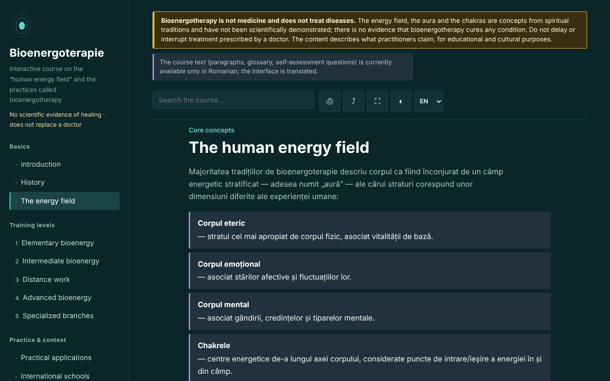

# Bioenergoterapie — interactive course

**English** · [Română](README.ro.md) · [Français](README.fr.md) · [Italiano](README.it.md) · [Español](README.es.md) · [Português](README.pt.md) · [Deutsch](README.de.md) · [Magyar](README.hu.md)

**Version:** 1.3.2 · **Last updated:** 2026-10-22

Interface languages: **Română, English, Français, Italiano, Español, Português (PT), Deutsch, Magyar**

An educational course on bioenergy therapy and the Pranic Healing system, in a single, offline HTML file. A belief-based practice, with no scientific evidence of healing.

**Live app:** https://chiuta.github.io/Bioenergoterapie/

> **Warning.** Bioenergy therapy is not medicine and does not treat diseases. The energy field, the aura and the chakras are concepts from spiritual traditions and have not been scientifically demonstrated; there is no evidence that bioenergy therapy cures any condition. Do not delay or interrupt a treatment prescribed by a doctor. The warning is displayed permanently at the top of every page of the app.

## What it is

A learning app in Romanian about bioenergy therapy as practitioners describe it: the "human energy field", historical landmarks (Therapeutic Touch, Pranic Healing, qigong and prana traditions), the five levels of the Pranic Healing system as a pedagogical framework, comparisons between traditions, a glossary. The content describes what practitioners claim and does not recommend treatments. Historical details and details about Romania that I could not verify are marked "[neverificat]" (unverified).

## Features

Checked in the code and in the browser:
- 13 sections (side menu, ☰ on mobile): Introduction, History, The energy field (with an SVG diagram of the chakra axis), five training levels with exercises, Practical applications, International schools, Glossary, Journal, Self-assessment.
- Search within the course, insensitive to diacritics.
- Direct links to sections (for example `#camp`); the browser's "back" button works between sections.
- Printing (only the displayed section, black and white), sharing (link), full screen, keeping the screen awake (where the browser allows it).
- Practice journal: free text, downloadable as `.txt` and reloadable from a file ("Încarcă (.txt)", with confirmation if it replaces existing text), with a button to insert the date and time into the note and a confirmation when clearing. By default nothing is saved in the browser; local retention is an option that you tick yourself.
- Self-assessment with 10 questions and explanations; the order of the answers is shuffled on every attempt; at the end, pointers appear to the sections to reread for the wrong answers.
- Respects `prefers-reduced-motion`; works from 390 px width; without JavaScript, all sections are displayed.

## User guide

1. Open the page and choose a section from the menu on the left (on mobile, press ☰).
2. Search for a term in the search field; press Enter or pick a result.
3. Exercises marked "Exercițiu practic" (Practical exercise) are attention and visualization exercises, not therapeutic procedures.
4. In "Jurnal" (Journal), write notes and download them (`.txt`) before closing the page: by default nothing is saved anywhere; optionally you can tick "Păstrează jurnalul în acest browser" (Keep the journal in this browser).
5. In "Autoevaluare" (Self-assessment), answer the questions; "Reia testul" (Retake the test) shuffles the answers again.

## Privacy and network

- Local storage: by default the app writes nothing to `localStorage`, `sessionStorage`, IndexedDB or cookies, and the journal exists only in the page's memory. Only if you yourself tick "Păstrează jurnalul în acest browser" are the (unencrypted) text and an indicator saved in `localStorage` (keys `bioenergoterapie.jurnal.*`); unticking deletes them.
- Network: the app makes no network requests and contains no external links; a CSP (`default-src 'none'`, the script authorized by SHA-256 hash, no `'unsafe-inline'` for scripts) blocks any external loading. In `<head>` there appear only addresses in the Open Graph metadata (`chiuta.github.io`), not accessed by the app.
- Permissions: it requests no permissions. "Ecran activ" (Screen Wake Lock) and "Distribuie" (Share; share menu or clipboard) work only when you press the buttons.
- Zero telemetry, no accounts.

## Limits and warnings

- It is not medical material and does not replace diagnosis or treatment. For any persistent symptom, see a doctor; the app does not recommend any procedure for diseases.
- The energy field, the aura, the chakras and "colored prana" have not been scientifically demonstrated; controlled research on related practices (for example Therapeutic Touch) has found no efficacy beyond placebo. The mention of an experiment published in JAMA in 1998 comes from the app author's memory and must be verified before being cited.
- The five-level structure follows the Pranic Healing system and is not the only possible organization of the field.
- The claims about the status of bioenergy therapy in Romania and about "Central European bioenergy therapy" are marked unverified.
- "Distant" practices are presented as the practitioners' premise, with no evidence of effect.

## Running locally / offline

Download `index.html` and open it in a browser; it needs no internet. For GitHub Pages, publish the repository (the `.nojekyll` file is included).

## History / Changelog

### 1.3.2 — 2026-10-22
- Native browser confirm()/prompt() boxes replaced by own dialogs translated into the 8 languages (clearing the journal, replacing it when loading a file, manual link copy).

### 1.2.0 — 2026-10-19
- In the diagram legend, a ♪ link (new tab) for each of the 7 centers to Aurora (`#<chakra>`; it does not start the sound), with a warning: the frequencies in Aurora are a modern convention, are not part of Pranic Healing and have no proven therapeutic effect.

### 1.1.0 — 2026-10-14
- Backup and data labeling (fff-kit).

### 1.0.0 — 12 October 2026
- The version and the date of the last update are shown in the app (footer).

### 11.10.2026 (third update) — 11 October 2026
- Journal: option "Păstrează jurnalul în acest browser" (off by default, with a warning that the storage is unencrypted; unticking deletes the saved copy). No new content about practices or health.

### 11.10.2026 (second update) — 11 October 2026
- Security: CSP with `script-src` by SHA-256 hash, no `'unsafe-inline'` for scripts.
- Journal: reloading from a `.txt` file and inserting the date and time (the journal stays only in the page's memory).
- Self-assessment: pointers to the sections to reread for wrong questions (no new content).

### 11.10.2026 — 11 October 2026
- Accessibility: h1 heading in the main area (the one in the side menu was hidden on mobile); axe check with no violations at 1280 and 360 px.
- The journal stays in memory only, intentionally (privacy); warning when leaving the page and `.txt` download.

## License

MIT — see the LICENSE file.

## Author

Alexio — Alexandru-Ionuț Chiuță, contact: alexio@trom.tf

## English summary

Bioenergoterapie is a single-file, offline, Romanian-language course on "bioenergy therapy" as practitioners describe it, structured around the Pranic Healing levels, with history, comparisons, glossary, practice journal and a 10-question quiz. A permanent notice states that the practice is not medicine and has no scientific evidence of healing; energy fields, auras and chakras are not scientifically demonstrated. The app makes no network requests, uses no browser storage and requests no permissions. Unverified historical and local claims are marked in the text.
