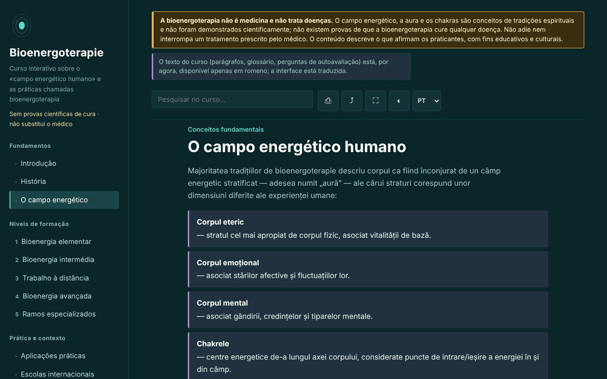

# Bioenergoterapie — curso interativo

[English](README.md) · [Română](README.ro.md) · [Français](README.fr.md) · [Italiano](README.it.md) · [Español](README.es.md) · **Português** · [Deutsch](README.de.md) · [Magyar](README.hu.md)

**Versão:** 2.0.0 · **Última atualização:** 2026-10-26

Idiomas da interface: **Română, English, Français, Italiano, Español, Português (PT), Deutsch, Magyar**

Curso educativo sobre a bioenergoterapia e o sistema Pranic Healing, num único ficheiro HTML, offline. Prática baseada em crenças, sem provas científicas de cura.

**Aplicação online:** https://chiuta.github.io/Bioenergoterapie/

> **Aviso.** A bioenergoterapia não é medicina e não trata doenças. O campo energético, a aura e os chakras são conceitos de tradições espirituais e não foram demonstrados cientificamente; não há provas de que a bioenergoterapia cure qualquer afeção. Não adie nem interrompa um tratamento prescrito por um médico. O aviso é apresentado de forma permanente no topo de cada página da aplicação.

## O que é

Uma aplicação de aprendizagem em romeno sobre a bioenergoterapia tal como a descrevem os praticantes: o «campo energético humano», marcos históricos (Therapeutic Touch, Pranic Healing, tradições do qigong e do prana), os cinco níveis do sistema Pranic Healing como estrutura pedagógica, comparações entre tradições, um glossário. O conteúdo descreve o que os praticantes defendem e não recomenda tratamentos. Os pormenores históricos e os relativos à Roménia que não consegui verificar estão assinalados com «[neverificat]» (não verificado).

## Funcionalidades

Verificadas no código e no navegador:
- 13 secções (menu lateral, ☰ no telemóvel): Introdução, História, O campo energético (com um diagrama SVG do eixo dos chakras), cinco níveis de formação com exercícios, Aplicações práticas, Escolas internacionais, Glossário, Diário, Autoavaliação.
- Pesquisa no curso, insensível aos sinais diacríticos.
- Ligações diretas às secções (por exemplo `#camp`); o botão «retroceder» do navegador funciona entre secções.
- Impressão (apenas a secção apresentada, a preto e branco), partilha (ligação), ecrã inteiro, manutenção do ecrã ativo (onde o navegador o permite).
- Diário de prática: texto livre, descarregável como `.txt` e recarregável a partir de um ficheiro («Încarcă (.txt)», com confirmação se substituir texto existente), com um botão para inserir a data e a hora na nota e uma confirmação ao esvaziar. Por predefinição, nada é guardado no navegador; a conservação local é uma opção que o utilizador assinala.
- Autoavaliação de 10 perguntas com explicações; a ordem das respostas é baralhada a cada tentativa; no final surgem remissões para as secções a reler nas respostas erradas.
- Respeita `prefers-reduced-motion`; funciona a partir de 390 px de largura; sem JavaScript, são apresentadas todas as secções.

## Manual de utilização

1. Abra a página e escolha uma secção no menu da esquerda (no telemóvel, prima ☰).
2. Pesquise um termo no campo de pesquisa; prima Enter ou escolha um resultado.
3. Os exercícios assinalados «Exercițiu practic» (Exercício prático) são exercícios de atenção e visualização, não procedimentos terapêuticos.
4. Em «Jurnal» (Diário), escreva notas e descarregue-as (`.txt`) antes de fechar a página: por predefinição não se guarda em lado nenhum; opcionalmente pode assinalar «Păstrează jurnalul în acest browser» (Manter o diário neste navegador).
5. Em «Autoevaluare» (Autoavaliação), responda às perguntas; «Reia testul» (Repetir o teste) baralha de novo as respostas.

## Privacidade e rede

- Armazenamento local: por predefinição, a aplicação não escreve nada em `localStorage`, `sessionStorage`, IndexedDB nem cookies, e o diário existe apenas na memória da página. Só se o utilizador assinalar «Păstrează jurnalul în acest browser» é que o texto (não cifrado) e um indicador são guardados em `localStorage` (chaves `bioenergoterapie.jurnal.*`); desassinalar elimina-os.
- Rede: a aplicação não faz qualquer pedido de rede e não contém ligações externas; uma CSP (`default-src 'none'`, script autorizado por hash SHA-256, sem `'unsafe-inline'` para scripts) bloqueia qualquer carregamento externo. No `<head>` surgem apenas endereços nos metadados Open Graph (`chiuta.github.io`), a que a aplicação não acede.
- Permissões: não pede permissões. «Ecran activ» (Screen Wake Lock) e «Distribuie» (Partilhar; menu de partilha ou área de transferência) funcionam apenas ao premir os botões.
- Zero telemetria, sem contas.

## Limites e avisos

- Não é material médico e não substitui o diagnóstico nem o tratamento. Perante qualquer sintoma persistente, consulte um médico; a aplicação não recomenda nenhum procedimento para doenças.
- O campo energético, a aura, os chakras e o «prana colorido» não foram demonstrados cientificamente; a investigação controlada sobre práticas afins (por exemplo, o Therapeutic Touch) não encontrou eficácia além do placebo. A menção de uma experiência publicada na JAMA em 1998 provém da memória do autor da aplicação e deve ser verificada antes de ser citada.
- A estrutura de cinco níveis segue o sistema Pranic Healing e não é a única organização possível da área.
- As afirmações sobre o estatuto da bioenergoterapia na Roménia e sobre a «bioenergoterapia centro-europeia» estão assinaladas como não verificadas.
- As práticas «à distância» são apresentadas como premissa dos praticantes, sem provas de efeito.

## Execução local / offline

Descarregue `index.html` e abra-o num navegador; não precisa de internet. Para o GitHub Pages, publique o repositório (o ficheiro `.nojekyll` está incluído).

## Histórico / Changelog

### 1.3.4 — 2026-10-22
- fff-kit 1.1.4: alvos de toque e tamanho mínimo do texto; alvos de toque/texto corrigidos

### 1.3.3 — 2026-10-22
- fff-kit 1.1.2: PBKDF2 600 000 iterações, proteção anti-clickjacking

### 1.3.2 — 2026-10-22
- As caixas confirm()/prompt() do navegador substituídas por diálogos próprios traduzidos nos 8 idiomas (limpar o diário, substituição ao carregar um ficheiro, cópia manual da ligação).

### 1.2.0 — 2026-10-19
- Na legenda do diagrama, uma ligação ♪ (novo separador) para cada um dos 7 centros para o Aurora (`#<chakra>`; não inicia o som), com um aviso: as frequências do Aurora são uma convenção moderna, não fazem parte do Pranic Healing e não têm qualquer efeito terapêutico comprovado.

### 1.1.0 — 2026-10-14
- Cópia de segurança e etiquetagem de dados (fff-kit).

### 1.0.0 — 12 de outubro de 2026
- A versão e a data da última atualização são apresentadas na aplicação (rodapé).

### 11.10.2026 (terceira atualização) — 11 de outubro de 2026
- Diário: opção «Păstrează jurnalul în acest browser» (desativada por predefinição, com um aviso de que o armazenamento não é cifrado; desassinalar elimina a cópia guardada). Sem conteúdo novo sobre práticas ou saúde.

### 11.10.2026 (segunda atualização) — 11 de outubro de 2026
- Segurança: CSP com `script-src` por hash SHA-256, sem `'unsafe-inline'` para scripts.
- Diário: recarregamento a partir de um ficheiro `.txt` e inserção da data e da hora (o diário permanece apenas na memória da página).
- Autoavaliação: remissões para as secções a reler nas perguntas erradas (sem conteúdo novo).

### 11.10.2026 — 11 de outubro de 2026
- Acessibilidade: título h1 na área principal (o do menu lateral estava oculto no telemóvel); verificação axe sem violações a 1280 e 360 px.
- O diário permanece apenas em memória, intencionalmente (privacidade); aviso ao sair da página e transferência `.txt`.

## Licença

MIT — ver o ficheiro LICENSE.

## Autor

Alexio — Alexandru-Ionuț Chiuță, contacto: alexio@trom.tf

## Resumo

A Bioenergoterapie é um curso em romeno, num único ficheiro e offline, sobre a «terapia bioenergética» tal como os praticantes a descrevem, estruturado em torno dos níveis do Pranic Healing, com história, comparações, glossário, diário de prática e um questionário de 10 perguntas. Um aviso permanente indica que a prática não é medicina e não tem provas científicas de cura; os campos de energia, as auras e os chakras não estão demonstrados cientificamente. A aplicação não faz pedidos de rede, não usa o armazenamento do navegador e não solicita permissões. As alegações históricas e locais não verificadas estão assinaladas no texto.
