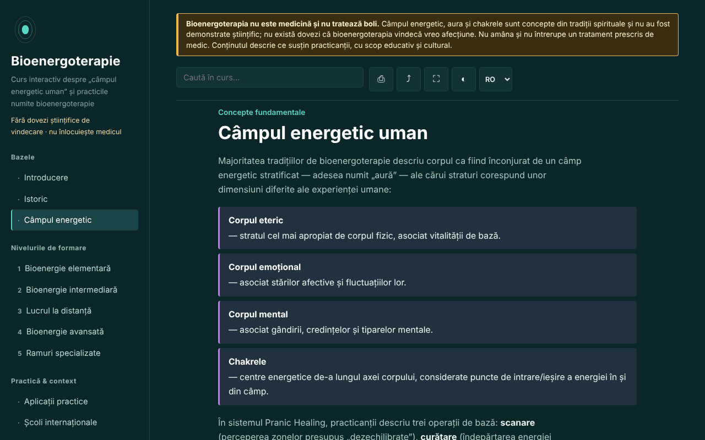

# Bioenergoterapie — curs interactiv

[English](README.md) · **Română** · [Français](README.fr.md) · [Italiano](README.it.md) · [Español](README.es.md) · [Português](README.pt.md) · [Deutsch](README.de.md) · [Magyar](README.hu.md)

**Versiune:** 1.3.6 · **Ultima actualizare:** 2026-10-26

Limbile interfeței: **Română, English, Français, Italiano, Español, Português (PT), Deutsch, Magyar**

Curs educativ despre bioenergoterapie și sistemul Pranic Healing, într-un singur fișier HTML, offline. Practică bazată pe credințe, fără dovezi științifice de vindecare.

**Live:** https://chiuta.github.io/Bioenergoterapie/

> **Avertisment.** Bioenergoterapia nu este medicină și nu tratează boli. Câmpul energetic, aura și chakrele sunt concepte din tradiții spirituale și nu au fost demonstrate științific; nu există dovezi că bioenergoterapia vindecă vreo afecțiune. Nu amâna și nu întrerupe un tratament prescris de medic. Avertismentul este afișat permanent în partea de sus a fiecărei pagini a aplicației.

## Ce este

O aplicație de învățare în română despre bioenergoterapie așa cum o descriu practicanții: „câmpul energetic uman", repere istorice (Therapeutic Touch, Pranic Healing, tradiții qigong și prana), cele cinci niveluri ale sistemului Pranic Healing ca schelet pedagogic, comparații între tradiții, glosar. Conținutul descrie ce susțin practicanții și nu recomandă tratamente. Detaliile istorice și cele despre România pe care nu le-am putut verifica sunt marcate „[neverificat]".

## Funcții

Verificate în cod și în browser:
- 13 secțiuni (meniu lateral, ☰ pe mobil): Introducere, Istoric, Câmpul energetic (cu diagramă SVG a axei chakrelor), cinci niveluri de formare cu exerciții, Aplicații practice, Școli internaționale, Glosar, Jurnal, Autoevaluare.
- Căutare în curs, fără sensibilitate la diacritice.
- Linkuri directe către secțiuni (de exemplu `#camp`), butonul „înapoi" al browserului funcționează între secțiuni.
- Tipărire (doar secțiunea afișată, alb-negru), distribuire (link), ecran complet, menținerea ecranului activ (unde browserul o permite).
- Jurnal de practică: text liber, descărcabil ca `.txt` și reîncărcabil din fișier („Încarcă (.txt)”, cu confirmare dacă înlocuiește text existent), cu buton pentru inserarea datei și orei în notă și confirmare la golire. Implicit nu se salvează nimic în browser; păstrarea locală este o opțiune bifată de tine.
- Autoevaluare de 10 întrebări cu explicații; ordinea răspunsurilor se amestecă la fiecare încercare; la final apar trimiteri către secțiunile de recitit pentru răspunsurile greșite.
- Respectă `prefers-reduced-motion`; funcționează de la 390 px lățime; fără JavaScript se afișează toate secțiunile.

## Manual de utilizare

1. Deschide pagina și alege o secțiune din meniul din stânga (pe mobil, apasă ☰).
2. Caută un termen în câmpul de căutare; apasă Enter sau alege un rezultat.
3. Exercițiile marcate „Exercițiu practic" sunt exerciții de atenție și vizualizare, nu proceduri terapeutice.
4. În „Jurnal" scrie notițe și descarcă-le (`.txt`) înainte de a închide pagina: implicit nu se salvează nicăieri; opțional poți bifa „Păstrează jurnalul în acest browser”.
5. În „Autoevaluare" răspunde la întrebări; „Reia testul" amestecă din nou răspunsurile.

## Confidențialitate și rețea

- Stocare locală: implicit aplicația nu scrie nimic în `localStorage`, `sessionStorage`, IndexedDB sau cookie-uri, iar jurnalul există doar în memoria paginii. Doar dacă bifezi tu „Păstrează jurnalul în acest browser”, textul (necriptat) și un indicator se salvează în `localStorage` (chei `bioenergoterapie.jurnal.*`); debifarea le șterge.
- Rețea: aplicația nu face nicio cerere de rețea și nu conține linkuri externe; o politică CSP (`default-src 'none'`, scriptul autorizat prin hash SHA-256, fără `'unsafe-inline'` pentru scripturi) blochează orice încărcare externă. În `<head>` apar doar adrese în metadatele Open Graph (`chiuta.github.io`), neaccesate de aplicație.
- Permisiuni: nu cere permisiuni. „Ecran activ" (Screen Wake Lock) și „Distribuie" (meniul de partajare sau clipboard) funcționează doar la apăsarea butoanelor.
- Zero telemetrie, fără conturi.

## Limite și avertismente

- Nu este material medical și nu înlocuiește diagnosticul sau tratamentul. Pentru orice simptom persistent, mergi la medic; aplicația nu recomandă nicio procedură pentru boli.
- Câmpul energetic, aura, chakrele și „prana colorată" nu au fost demonstrate științific; cercetările controlate asupra practicilor înrudite (de exemplu Therapeutic Touch) nu au găsit eficacitate dincolo de placebo. Mențiunea unui experiment publicat în JAMA în 1998 este din memoria autorului aplicației și trebuie verificată înainte de a fi citată.
- Structura pe cinci niveluri urmează sistemul Pranic Healing și nu este singura organizare posibilă a domeniului.
- Afirmațiile despre statutul bioenergoterapiei în România și despre „bioenergoterapia central-europeană" sunt marcate neverificate.
- Practicile „la distanță" sunt prezentate ca premisă a practicanților, fără dovezi de efect.

## Rulare locală / offline

Descarcă `index.html` și deschide-l în browser; nu are nevoie de internet. Pentru GitHub Pages, publică repository-ul (fișierul `.nojekyll` este inclus).

## Istoric / Changelog

### 1.3.4 — 2026-10-22
- fff-kit 1.1.4: ținte tactile și text minim; ținte tactile/text corectate

### 1.3.3 — 2026-10-22
- fff-kit 1.1.2: PBKDF2 600 000 iterații, protecție anti-clickjacking

### 1.3.2 — 2026-10-22
- Casetele confirm()/prompt() ale browserului înlocuite cu dialoguri proprii, traduse în cele 8 limbi (golirea jurnalului, înlocuirea lui la încărcarea unui fișier, copierea manuală a linkului).

### 1.2.0 — 2026-10-19
- În legenda diagramei, link ♪ (filă nouă) pentru fiecare dintre cele 7 centre spre Aurora (`#<chakră>`; nu pornește sunetul), cu avertisment: frecvențele din Aurora sunt o convenție modernă, nu fac parte din Pranic Healing și nu au efect terapeutic dovedit.

### 1.1.0 — 2026-10-14
- Copie de rezervă și etichetare date (fff-kit).

### 1.0.0 — 12 octombrie 2026
- Versiunea și data ultimei actualizări sunt afișate în aplicație (subsol).

### 11.10.2026 (a treia actualizare) — 11 octombrie 2026
- Jurnal: opțiune „Păstrează jurnalul în acest browser” (dezactivată implicit, cu avertisment că stocarea e necriptată; debifarea șterge copia salvată). Fără conținut nou despre practici sau sănătate.

### 11.10.2026 (a doua actualizare) — 11 octombrie 2026
- Securitate: CSP cu `script-src` pe hash SHA-256, fără `'unsafe-inline'` pentru scripturi.
- Jurnal: reîncărcare din fișier `.txt` și inserarea datei și orei (jurnalul rămâne doar în memoria paginii).
- Autoevaluare: trimiteri către secțiunile de recitit pentru întrebările greșite (fără conținut nou).

### 11.10.2026 — 11 octombrie 2026
- Accesibilitate: titlu h1 în zona principală (cel din meniul lateral era ascuns pe mobil); verificare axe fără încălcări la 1280 și 360 px.
- Jurnalul rămâne doar în memorie, intenționat (confidențialitate); avertisment la părăsirea paginii și descărcare .txt.

## Licență

MIT — vezi fișierul LICENSE.

## Autor

Alexio — Alexandru-Ionuț Chiuță, contact: alexio@trom.tf

## Rezumat

Bioenergoterapie este un curs într-un singur fișier, offline, în limba română, despre „terapia bioenergetică” așa cum o descriu practicienii, structurat pe nivelurile Pranic Healing, cu istorie, comparații, glosar, jurnal de practică și un test de 10 întrebări. O notă permanentă precizează că practica nu este medicină și nu are dovezi științifice de vindecare; câmpurile energetice, aurele și chakrele nu sunt demonstrate științific. Aplicația nu face cereri de rețea, nu folosește stocarea browserului și nu cere permisiuni. Afirmațiile istorice și locale neverificate sunt marcate în text.
